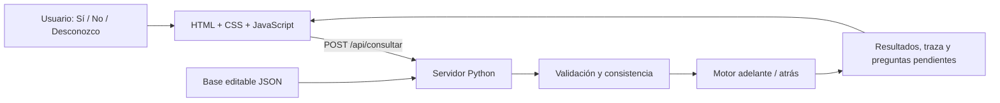

# Arquitectura y correspondencia con los documentos

## Tecnología

El navegador presenta HTML/CSS y JavaScript captura respuestas. `fetch` comunica la consulta con Python mediante HTTP en el mismo origen. Python ejecuta el razonamiento y devuelve JSON. No se requiere PHP ni una base de datos relacional.



## Requisitos

| Requisito | Implementación |
|---|---|
| RF-01 Iniciar consulta | Motivo observado y preguntas adaptativas |
| RF-02 Conocimiento documentado | JSON con Q, C, A, R y fuentes F |
| RF-03 Ambos encadenamientos | `consultar` combina automáticamente `adelante` y `EncadenamientoAtras.demostrar` |
| RF-04 Uno, varios o ningún resultado | Agrupación por tipo y estado de la meta |
| RF-05 Explicación | Árbol de justificaciones y secuencia de reglas con premisas y fuentes |
| RF-06 Desconocidos | Kleene fuerte; D separada de pregunta sin responder |
| RF-07 Terminación | Registro de reglas activadas, caché y detección de ciclos |
| RF-08 Reinicio | Memoria nueva, sin derivaciones previas |
| RF-09 Límites | Aviso educativo y alcance del resultado |

## Transcripción y decisiones añadidas

Se conservaron los identificadores y significados de las tablas de Contenido: Q01–Q45, C01–C36, A01–A15, R01–R51 y F01–F03. Los antecedentes se convirtieron a árboles JSON con `todos` (Y), `alguno` (O), `no` (NO) y literales `hecho/valor`. Un literal de valor F es una negación explícita.

El DOCX menciona un JSON adjunto, pero el archivo disponible contiene tablas y tres imágenes, sin ese adjunto. Se reconstruyó la base a partir de las tablas. Las referencias bibliográficas F01–F03 requieren completar títulos, enlaces y cotejo de páginas antes de la entrega final.

El documento exige política de conflictos, selección adaptativa y ayudas sin fijar todos sus detalles. Se adoptaron estas decisiones:

- Reglas en orden ascendente de identificador, sin prioridades clínicas añadidas.
- Adelante prioriza la pregunta que participa en más metas indeterminadas. Empates por ID.
- Atrás recorre dependencias de la meta y presenta preguntas pendientes por ID. No pregunta por ramas falsas ni por una meta ya sustentada.
- Una respuesta D no se repite automáticamente; puede corregirse manualmente.
- Las ayudas se redactaron a partir de las precauciones del documento. Consultarlas no modifica hechos.

## Consulta automática orientada al usuario

La pantalla principal no pide elegir algoritmo ni meta, ni muestra un total de preguntas. La persona aporta una observación inicial al elegir un motivo; por ejemplo, «Los peces boquean» corresponde a Q16=V y aparece en el historial para corregirla. «Otro problema» no afirma ningún hecho inicial.

`consulta.json` define metas relacionadas con cada motivo y nuevas líneas de investigación cuando aparecen indicios. Es una política de navegación añadida, no conocimiento diagnóstico tomado de las fuentes. No altera R01–R51 ni introduce porcentajes de probabilidad.

En cada respuesta, `consulta.py`:

1. Valida consistencia y ejecuta adelante hasta alcanzar un punto fijo.
2. Selecciona las metas del motivo y amplía la investigación con los indicios obtenidos.
3. Ejecuta atrás para conocer el estado de cada meta y las premisas que faltan.
4. Descarta preguntas de metas ya sustentadas o no sustentables y las ramas decididas por Y/O. Las preguntas respondidas D no se repiten.
5. Presenta una sola pregunta, por orden de metas de la política y luego ID. No hay límite artificial de preguntas.
6. Termina cuando no quedan preguntas pertinentes sin responder; si quedan D, comunica la información insuficiente. Un conflicto exige revisar las respuestas antes de continuar.

Se recalcula desde cero al corregir una respuesta. Las preguntas descartadas pueden volver a ser pertinentes después de una corrección. Las condiciones independientes y sus verificaciones se acumulan; no se fuerza una causa única.

La conclusión está limitada al motivo y a los indicios explorados. No se afirma revisar todo el sistema. La interfaz muestra posibles problemas y hasta tres verificaciones inicialmente, con las restantes desplegables. Los códigos de reglas, fuentes y comparación se conservan en el detalle plegado. El laboratorio `/academico.html` permite la evaluación aislada de algoritmos y el catálogo, sin formar parte de la consulta ordinaria.

El criterio de selección descrito antes para `ejecutar` se conserva únicamente en el laboratorio; el recorrido automático utiliza el orden de metas de la política descrito aquí.

## Semántica y consistencia

V significa afirmación, F negación explícita y D información insuficiente. Una pregunta no respondida se evalúa D, pero sigue disponible para preguntar.

En Y, un F domina; sin F pero con D, el resultado es D. En O, un V domina; sin V pero con D, el resultado es D. NO intercambia V/F y preserva D. Solo un antecedente V activa una regla.

No derivar C01 no produce C01=F en la memoria. Se rechazan negaciones de conclusiones derivadas. En búsqueda hacia atrás, F representa fracaso de prueba con las reglas y respuestas actuales, no que el problema sea imposible en el mundo real. Este estado no se agrega como hecho negativo.

Las 24 restricciones se comprueban contra respuestas explícitas de la misma muestra o período. Una contradicción convierte las preguntas involucradas en D para la inferencia, conservando sus respuestas originales para revisión. Los otros hechos independientes siguen siendo evaluables; una disyunción puede sustentarse mediante otra premisa válida.

Las restricciones validan, no rellenan respuestas ausentes: Q01=V y Q02 ausente no genera automáticamente Q02=V. Cada petición crea memoria nueva; corregir una respuesta recalcula todo. No hay persistencia de consultas ni cookies.

## Algoritmos

### Hacia adelante

```text
copiar hechos consistentes en memoria
repetir:
    recorrer reglas no activadas por ID
    si antecedente es V:
        registrar regla, premisas y fuentes
        agregar consecuente V
    terminar si no se activó ninguna regla nueva
```

Cada regla se activa como máximo una vez. Varias reglas pueden justificar una misma salida. La traza registra las premisas disponibles en el instante de activación. El conjunto de reglas es finito y el cargador rechaza ciclos.

### Hacia atrás

```text
probar(meta):
    si es pregunta: devolver respuesta o D
    si está en caché: devolver estado
    si está en pila activa: devolver D (protección adicional)
    buscar reglas que concluyan la meta
    probar recursivamente sus premisas
    registrar las derivaciones completas
    combinar alternativas con O y guardar en caché
```

Se conservan las derivaciones completas de las reglas alternativas. Los pendientes siguen solo ramas indeterminadas que podrían cambiar el estado. Los resultados secundarios son las conclusiones probadas al explorar las dependencias.

### Comparación

Se ejecutan ambos algoritmos desde los mismos hechos y meta. Se compara el sustento de esa meta y se muestran estados, resultados, reglas consideradas/activadas y preguntas sugeridas. Adelante explora toda la base; atrás se centra en el objetivo, por lo que sus listas totales pueden diferir.

En modo adelante, el estado detallado de la meta y la selección de preguntas usan un análisis auxiliar hacia atrás. Su traza y sus resultados proceden exclusivamente del encadenamiento hacia adelante.

## API

| Ruta | Uso |
|---|---|
| GET `/api/conocimientos` | Catálogo público |
| GET `/api/ejemplos` | Casos simulados |
| GET `/api/temas` | Motivos y observaciones iniciales |
| POST `/api/consultar` | `{ "topic":"fish", "facts":{"Q16":"V"} }`, sin modo ni meta |
| POST `/api/inferir` | `{ "facts": {"Q02":"V","Q16":"V"}, "mode":"forward", "goal":"C27" }` |
| POST `/api/comparar` | Mismos hechos y meta, ambos algoritmos |

Entradas inválidas: HTTP 400. Rutas no publicadas: 404. No se exponen documentos originales, código Python ni Git. El servidor escucha en 127.0.0.1 y es exclusivo para desarrollo local.

## Pendientes académicos

El prototipo no sustituye el informe institucional completo: faltan portada, integrantes, aprobación docente, bibliografía verificada, análisis académico y evidencias de exposición. No se afirma validación profesional ni evaluación en instalaciones reales.
